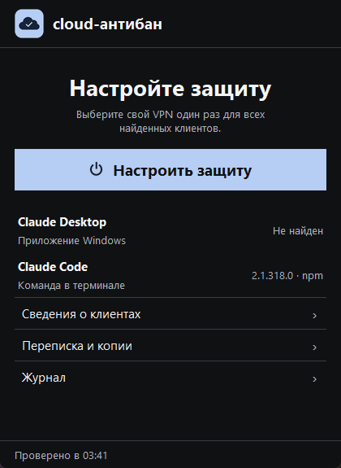

# cloud-антибан — защита подключения Claude при обрыве VPN

**cloud-антибан** — бесплатная утилита для Windows 10/11 x64. Она ограничивает новые сетевые соединения Claude Code и Claude Desktop выбранным VPN-интерфейсом. Это помогает избежать случайного выхода с обычного IP-адреса при сбое VPN. Правила охватывают обнаруженные клиенты во всех проектах.

**[Скачать cloud-антибан 1.2 для Windows x64](https://github.com/polakovmaks011-boop/cloud-antiban/releases/download/v1.2/cloud-antiban-1.2-windows-x64.zip)** · [Что проверено в предварительном выпуске](https://github.com/polakovmaks011-boop/cloud-antiban/releases/tag/v1.2) · [SHA-256 архива](https://github.com/polakovmaks011-boop/cloud-antiban/releases/download/v1.2/SHA256SUMS.txt)

## Первый запуск

1. Распакуйте весь ZIP в постоянную папку. Запустите `cloud-антибан.exe`. Сборка переносимая, без подписи издателя.
2. На главном экране видны два клиента. **Claude Code** — команда в терминале, в том числе установленная через npm. **Claude Desktop** — приложение с окном. Утилита проверяет исполняемый файл и подпись Anthropic. Если установленный клиент отсутствует в списке, укажите папку через **Сведения о клиентах**.
3. Включите VPN, нажмите **Настроить защиту**, выберите его сетевой интерфейс и нажмите **Включить защиту**. Проверьте список файлов и подтвердите запрос Windows. Открывайте Claude привычным способом.
4. В **Журнале** нажмите **Проверить обрыв · сервер в Японии**. Через несколько секунд после подтверждения Windows появятся результаты для нового соединения, открытого потока и восстановления связи.

## Возможности

| Функция | Как пользоваться |
| --- | --- |
| **Проверка при обрыве** | Японский контрольный сервер подтверждает получение случайных меток по TLS. Утилита открывает поток через выбранный интерфейс, временно снимает разрешение только у тестового процесса и проверяет ещё одну отправку и новое соединение. По завершении проверяет восстановление связи. Аккаунт Claude для этого не нужен. |
| **Мониторинг** | Утилита опрашивает состояние интерфейса каждые 2 секунды и в фоне сверяет файлы клиентов, фильтры Windows и маршруты примерно каждые 15 секунд. При расхождении на главном экране появляется причина. Статус **Правила проверены** означает, что Windows подтвердила фильтры. |
| **Журнал событий** | Локально сохраняются изменения состояния VPN и результаты проверок. Если Windows ведёт аудит и разрешает читать Security, журнал также показывает зарегистрированные исходящие блокировки файлов Claude (событие 5157). Это событие может относиться и к другому правилу Windows. |
| **Резервные копии** | В разделе **Переписка и копии** создайте зашифрованную копию всех локальных диалогов Claude Code. Настройте интервал 1, 5, 15 или 60 минут либо сохранение при обрыве. В открытой копии можно искать по диалогам, читать их офлайн, вернуть выбранную сессию в CLI или экспортировать текст с маскировкой известных форматов секретов. |
| **Восстановление правил** | При изменении состава программ утилита предложит временно заблокировать новые соединения обнаруженных файлов. После подтверждения Windows блокировка действует до повторного включения защиты. Если адаптер пропал, прежние правила сохраняются. Подключите VPN или примените сохранённый профиль. |
| **Запуск с Windows** | Правила устанавливаются как постоянные в Windows Filtering Platform. Переключатель **Мониторинг при входе в Windows** открывает утилиту после входа. Чтобы также возобновлялось расписание копий, включите **Запомнить расписание всех диалогов**. Windows защитит пароль с помощью DPAPI текущего пользователя. |
| **IPv6, DNS и прокси** | Правила клиента охватывают IPv4 и IPv6. Кнопка **Маршруты, DNS и прокси** показывает пути до контрольных адресов и настроенных DNS-серверов. При маршруте мимо VPN или обнаруженном системном прокси утилита выводит предупреждение. |
| **Несколько VPN** | Выберите интерфейс в настройках VPN и нажмите **Сохранить выбранный**. Позже подключите нужный VPN, выберите его по имени и нажмите **Применить профиль**. Изменение вступает в силу после подтверждения Windows. |

## Что проверено на Windows

При проверке IPv4 через Happ японский сервер ответил по открытому соединению. После имитации обрыва Windows явно отказала в новом TCP-соединении (`WSAEACCES`). На следующую отправку по старому потоку ответ не пришёл. После снятия тестовых фильтров сервер снова ответил.

Отсутствие ответа не устанавливает, дошли ли данные старого потока до сервера. Для проверки физического отключения VPN и перезагрузки нужен отдельный стенд. На японском сервере пока нет публичного IPv6. Для этой части тест выводит **«не проверено»**. В журнале доступен также отдельный TCP-самотест с собственным IPv4 или IPv6 и портом.

## Совместимость и данные

- **Windows 10/11 x64**, нативный Claude Code и Claude Desktop для Windows. Подходит VPN с отдельным сетевым интерфейсом. Правила привязаны к путям файлов клиента. Для нового пути после обновления ограничение вступает в силу после применения правил.
- **Сетевой охват.** Фильтры действуют для обнаруженных программ. Системный DNS, выход внешнего прокси, браузер, WSL и сторонние процессы используют собственные подключения. Диагностика маршрутов помогает заметить расхождения. Внешний тест видит IP соединения и случайную метку. Содержимое чатов остаётся на компьютере.
- **История.** Архивы Claude Code хранятся в `%LOCALAPPDATA%\SessionHarbor\archives` и шифруются AES-256-GCM с ключом из пароля (scrypt). Один снимок вмещает до 128 МиБ. Сохраните пароль, чтобы читать копию на другом компьютере. Хранилища авторизации исключены. Перед передачей текстового экспорта проверьте вставленные вручную пароли и личные сведения. Для Claude Desktop доступна кнопка официального экспорта через аккаунт.
- **Отключение.** Закрытие окна останавливает журналирование и автокопии. Чтобы снять сетевые ограничения, откройте настройки VPN и нажмите **Снять правило…**. Перед перемещением или удалением программы можно там же выключить автозапуск.

Сборка бесплатна. Решения о доступе к аккаунту принимает Anthropic. Проект независим от Anthropic. [Условия использования](TERMS.md) · [Сообщить об ошибке](https://github.com/polakovmaks011-boop/cloud-antiban/issues)

